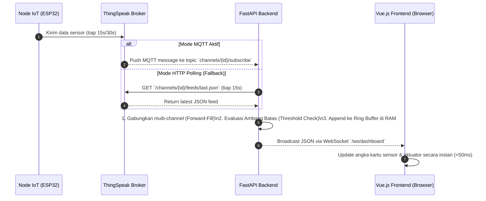
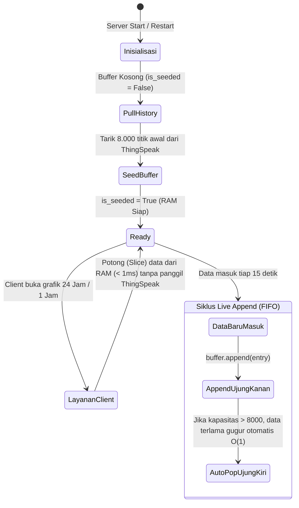
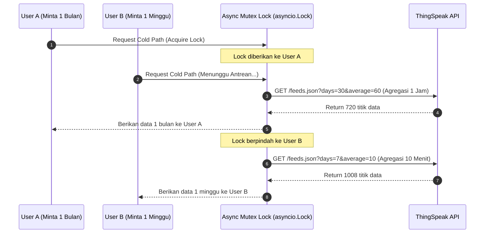

# 📊 Arsitektur Sistem Telemetri & Visualisasi Grafik Real-Time (G-Connect)

> **Dokumen Teknis untuk Presentasi Akademik & Sidang Proyek**  
> **Topik:** *Dual-Track Architecture (Hot-Path In-Memory FIFO Ring Buffer & Cold-Path Async Queue) pada Sistem Monitoring IoT Smart Farming.*

---

## 📌 1. Latar Belakang Masalah (*Problem Statement*)

Dalam perancangan platform IoT berbasis *cloud* dengan **ThingSpeak** sebagai perantara data:
1. **Aturan Pembatasan API (*Rate Limit HTTP 429*)**:
   ThingSpeak membatasi request maksimal **1 request per 15 detik per channel**.
2. **Tantangan Banyak Pengguna (*Multi-Client Concurrency*)**:
   Jika terdapat 10 atau 100 pengguna membuka grafik atau me-refresh dashboard secara bersamaan, menembak langsung API ThingSpeak akan menyebabkan **Error 429 (Request Ditolak/Gagal)** atau *loading* yang sangat lama.
3. **Kebutuhan Realtime & Keandalan (*Zero Data Loss & Low Latency*)**:
   Dashboard memerlukan pembaruan status aktuator dan sensor instan (< 1 detik) serta grafik 24 jam yang cepat dibuka tanpa membebani kuota API pihak ketiga.

---

## 🏗️ 2. Diagram Alir Sistem Keseluruhan (*End-to-End Flowchart*)

```mermaid
flowchart TD
    subgraph SENSOR_LAYER["1. Lapisan Perangkat Keras (Node IoT)"]
        Node1["Node Utama (NPK, pH, Suhu, eC)"]
        Node2["Node Pendukung (Soil Probe, Box Panel)"]
    end

    subgraph CLOUD_LAYER["2. Lapisan Cloud (ThingSpeak)"]
        TS_Ch1["Channel Utama (8 Field)"]
        TS_Ch2["Channel Pendukung (8 Field)"]
    end

    subgraph BACKEND_LAYER["3. Lapisan Server Backend (FastAPI)"]
        direction TB
        subgraph INGESTION["Data Ingestion"]
            MQTT_Listener["ThingSpeak MQTT Push (Prioritas)"]
            HTTP_Poller["HTTP Polling Fallback (15 Detik)"]
        end
        
        Merge_Engine["Multi-Channel Merging Engine & Watchdog"]
        
        subgraph DUAL_TRACK["Dual-Track Strategy"]
            Ring_Buffer[("Hot-Path Ring Buffer (RAM)\ncollections.deque(maxlen=8000)\nKapasitas: ~33.3 Jam")]
            Cold_Lock["Cold-Path Mutex Lock\n(asyncio.Lock)\nAntrean Arsip 1W/1M"]
        end
        
        WS_Broadcaster["WebSocket Manager (/ws/dashboard)"]
    end

    subgraph CLIENT_LAYER["4. Lapisan Pengguna (Frontend Vue 3 + Tailwind)"]
        Browser1["Client 1 (Dashboard Live)"]
        Browser2["Client 2 (Grafik 24 Jam)"]
        Browser3["Client 3 (Arsip 1 Bulan)"]
    end

    Node1 -->|Kirim Tiap 15s| TS_Ch1
    Node2 -->|Kirim Tiap 15s| TS_Ch2

    TS_Ch1 --> MQTT_Listener
    TS_Ch2 --> MQTT_Listener
    TS_Ch1 -.->|Cadangan| HTTP_Poller
    TS_Ch2 -.->|Cadangan| HTTP_Poller

    MQTT_Listener --> Merge_Engine
    HTTP_Poller --> Merge_Engine

    Merge_Engine -->|1. Push Instan| WS_Broadcaster
    Merge_Engine -->|2. Append FIFO O(1)| Ring_Buffer

    WS_Broadcaster ==>|WebSocket Stream| Browser1
    Browser2 -->|Request 1H/24H| Ring_Buffer
    Ring_Buffer ==>|Respons < 1ms (Instan)| Browser2
    
    Browser3 -->|Request 1W/1M| Cold_Lock
    Cold_Lock -->|Antrean Aman| TS_Ch1
    Cold_Lock -->|Antrean Aman| TS_Ch2
```

---

## ⚡ 3. Mekanisme 1: Jalur Realtime (*Live Streaming*)



### Karakteristik Kunci Jalur Realtime:
* **Frontend Pasif (Efisien)**: Browser pengguna **tidak pernah melakukan request berulang kali (*zero polling*)**.
* **Kecepatan Tinggi**: Data langsung di-*push* melalui WebSocket begitu tiba di server backend.
* **Keamanan Kredensial**: API Key ThingSpeak tersimpan aman di database server backend, tidak pernah bocor ke browser client.

---

## 🚀 4. Mekanisme 2: Jalur Cepat Grafik 24 Jam (*Hot Path — FIFO Ring Buffer*)

### Perhitungan Matematis Kapasitas Memori:
Jika sensor mengirim data setiap $T = 15\text{ detik}$:
$$\text{Data per Menit} = \frac{60}{15} = 4\text{ data}$$
$$\text{Data per Jam} = 4 \times 60 = 240\text{ data}$$
$$\text{Data per Hari (24 Jam)} = 240 \times 24 = 5.760\text{ data}$$

Dengan mengalokasikan **`collections.deque(maxlen=8000)`**:
$$\text{Rentang Waktu Maksimal} = \frac{8000 \times 15}{3600} \approx \mathbf{33{,}3\text{ Jam (~1,4 Hari)}}$$



### Keunggulan Akademik *Hot Path*:
1. **Kompleksitas Waktu $O(1)$**:
   Operasi penambahan data baru (*append*) dan pembuangan data tertua (*popleft*) pada struktur data Double-Ended Queue (`deque`) di Python berjalan dalam waktu konstan $O(1)$, bukan $O(N)$.
2. **Skalabilitas Tak Terbatas**:
   1.000 pengguna yang membuka grafik 24 jam secara bersamaan dilayani langsung oleh RAM backend dalam waktu **< 1 milidetik**. Beban request ke server ThingSpeak adalah **0 (Nol)**.

---

## 🛡️ 5. Mekanisme 3: *Auto-Seeding* & *Fallback Forward-Fill*

### 1. Mengapa *Auto-Seeding* Diperlukan?
* Saat server backend restart/deploy ulang, RAM menjadi kosong.
* Sistem memiliki penanda state `_seeded_nodes: set`.
* Request grafik pertama setelah restart akan menarik **8.000 data riwayat awal secara aman dari ThingSpeak**, menyimpannya di `deque`, lalu menandai `_seeded_nodes.add(node_id)`. Request selanjutnya akan 100% menggunakan *Hot Path*.

### 2. Mekanisme *Fallback Forward-Fill* (Mencegah Kartu Kosong/`--`):
Sensor industri (Modbus RS485 / NPK probe) terkadang mengalami gangguan transien 1 siklus (*packet drop / CRC error*).
* **Solusi**: Jika field sensor tertentu tidak terbaca pada paket data terbaru, backend melakukan pencarian mundur (*backward traversal*) pada `history_feeds` untuk mengambil nilai valid terakhir.
* **Hasil**: Tampilan kartu sensor di dashboard **tetap terisi data valid dan stabil**, tanpa pernah berkedip menjadi `--`.

---

## ❄️ 6. Mekanisme 4: Jalur Arsip Rentang Panjang (*Cold Path — Async Mutex Queue*)

Untuk rentang waktu yang berada di luar kapasitas RAM 24 jam (misalnya **1 Minggu, 1 Bulan, atau Rentang Tanggal Kustom**):



* **Fitur Agregasi Otomatis**: Menggunakan parameter `average=60` (rata-rata per 60 menit) dari ThingSpeak sehingga data 1 bulan hanya memakan 720 titik data (sangat ringan dan cepat dirender oleh chart).
* **Proteksi Mutex**: Menggunakan `asyncio.Lock()` agar request arsip yang berbarengan dieksekusi secara bergiliran (*serialized queue*), menjamin **tidak akan pernah terkena Error 429 Rate Limit**.

---

## 📊 7. Ringkasan Perbandingan Teknis: Hot Path vs Cold Path

| Parameter | 🚀 Hot Path (Live & 24 Jam) | ❄️ Cold Path (1 Minggu & 1 Bulan) |
| :--- | :--- | :--- |
| **Sumber Data** | Memori RAM Server (`collections.deque`) | API ThingSpeak Cloud |
| **Kecepatan Respons** | **< 1 Milidetik (Instan)** | 300 – 800 Milidetik |
| **Kapasitas Titik Data** | 8.000 Titik Resolusi Penuh | Teragregasi (`average=10` atau `average=60`) |
| **Konsumsi Kuota ThingSpeak** | **0 Request (Hemat 100%)** | 1 Request per query (antrean aman) |
| **Maksimal Beban Pengguna** | Ribuan pengguna serentak | Dieksekusi bergantian (*Mutex Lock*) |

---

## 🎓 8. Poin Kunci untuk Menjawab Pertanyaan Dosen Penguji

Jika dosen menanyakan arsitektur ini, berikut intisari jawabannya:

1. **Kenapa tidak langsung query ke ThingSpeak setiap kali user buka grafik?**
   > *"ThingSpeak memiliki Rate Limit ketat (1 request per 15 detik). Jika 5 penguji/user membuka grafik bersamaan, request ke-2 dan seterusnya akan gagal (Error 429). Oleh karena itu, backend kami menggunakan arsitektur Dual-Track dengan In-Memory Ring Buffer."*

2. **Bagaimana cara kerja Ring Buffer di memori backend?**
   > *"Kami memanfaatkan struktur data Double-Ended Queue (`collections.deque(maxlen=8000)`) di FastAPI. Begitu data baru masuk tiap 15 detik, data di-append dan data paling lama (>33 jam) terbuang otomatis dengan efisiensi waktu konstan $O(1)$."*

3. **Bagaimana jika server backend baru saja restart dan memori kosong?**
   > *"Sistem kami memiliki mekanisme Auto-Seeding: saat pertama kali node diakses, backend mengambil data riwayat 8.000 titik awal dari ThingSpeak untuk mengisi buffer, baru setelah itu buffer terus ter-update secara mandiri oleh live stream."*

4. **Bagaimana jika sensor mengalami packet loss atau gangguan kabel Modbus?**
   > *"Backend kami menerapkan Forward-Fill Fallback: nilai sensor yang hilang sementara pada paket terbaru akan diisi oleh pembacaan valid terakhir dari riwayat, sehingga kartu dashboard tidak pernah crash atau blank."*
